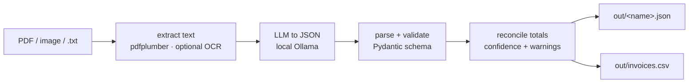

# doc-extract

Turn a pile of invoices and receipts into clean structured data (JSON + CSV), and have the maths checked before anyone trusts it. Runs on a local LLM, so no document ever leaves the machine.

## The problem

"Type these invoices into the spreadsheet" is one of the most common bits of office drudgery, and the one people most want to hand to a bot. The catch is that a model will happily read a total wrong and sound just as confident. So this tool does two jobs, not one: a local LLM reads the document into a fixed schema, and then plain Python re-checks every number. If the line items don't add up to the subtotal, or subtotal plus tax doesn't equal the total, the row is flagged `low` confidence with the exact discrepancy, instead of being passed off as done.

## What it does

- Reads PDFs (text layer via pdfplumber) and plain-text receipts out of the box. Scanned images/PDFs work too with optional OCR.
- Extracts to a **Pydantic** schema: vendor, invoice number, date, currency, line items (description / qty / unit price / amount), subtotal, tax, total.
- Normalizes deterministically: dates to ISO `YYYY-MM-DD`, money strings like `$1,234.56` or `(45.00)` to floats.
- **Reconciles the totals** and emits a confidence flag plus a list of exact warnings.
- Writes `out/<name>.json` per document and one aggregate `out/invoices.csv`.
- Labels every output AI-generated and marks that a human must review it.

## How it works



The LLM is the only non-deterministic step, and it only ever reads. Every number it returns is re-derived and checked by `postprocess.py` with no model in the loop, so a hallucinated total gets caught by arithmetic rather than believed.

## Quickstart

```bash
make install          # venv + dependencies
make test             # offline, no network, no API key, no tesseract
ollama serve          # a local model must be reachable for a live run
make run              # extract sample/ -> out/   (or: ./run.sh sample/)
```

Defaults point at local Ollama (`LLM_BASE_URL=http://127.0.0.1:11434/v1`, `LLM_MODEL=qwen3:30b-a3b-instruct-2507-q4_K_M`). Copy `.env.example` to `.env` to point at any OpenAI-compatible endpoint. `make test` needs none of this: the LLM is mocked.

## Sample run

`python -m doc_extract sample/` on the bundled documents:

```
  - acme-cloud-invoice.pdf: HIGH
  - blue-ridge-receipt.pdf: HIGH
  - corner-cafe-receipt.txt: HIGH
  - northwind-invoice.pdf: LOW (1 warning)

Wrote 4 JSON file(s) + out/invoices.csv
Output is AI-generated. Review before use.
```

`northwind-invoice.pdf` has a deliberately wrong total (subtotal 2140 + tax 214 should be 2354, the document says 2154). The extraction is faithful to the page, and reconciliation catches the error:

**In** (`sample/northwind-invoice.pdf`):

```
Northwind Traders LLC
Invoice No: NW-5521   Invoice Date: 04/18/2024   Currency: USD
Consulting (hours)       12   150.00   1800.00
Travel reimbursement      1   340.00    340.00
Subtotal: 2,140.00   Tax (10%): 214.00   Total: 2,154.00
```

**Out** (`out/northwind-invoice.json`):

```json
{
  "source": "northwind-invoice.pdf",
  "ai_generated": true,
  "notice": "AI-generated extraction. A human must review before use.",
  "confidence": "low",
  "warnings": ["subtotal 2140.0 + tax 214.0 != total 2154.0"],
  "invoice": {
    "vendor": "Northwind Traders LLC",
    "invoice_number": "NW-5521",
    "date": "2024-04-18",
    "currency": "USD",
    "line_items": [
      {"description": "Consulting (hours)", "qty": 12.0, "unit_price": 150.0, "amount": 1800.0},
      {"description": "Travel reimbursement", "qty": 1.0, "unit_price": 340.0, "amount": 340.0}
    ],
    "subtotal": 2140.0, "tax": 214.0, "total": 2154.0
  }
}
```

And the aggregate `out/invoices.csv`:

```
source,vendor,invoice_number,date,currency,subtotal,tax,total,line_items,confidence,warnings
acme-cloud-invoice.pdf,"ACME Cloud Services, Inc.",ACM-2024-0417,2024-03-15,USD,368.0,31.28,399.28,4,high,
blue-ridge-receipt.pdf,Blue Ridge Hardware,BRH-88213,2024-04-02,$,132.49,9.27,141.76,3,high,
corner-cafe-receipt.txt,Corner Cafe,CC-10432,2024-05-12,GBP,15.5,0.0,15.5,3,high,
northwind-invoice.pdf,Northwind Traders LLC,NW-5521,2024-04-18,USD,2140.0,214.0,2154.0,2,low,subtotal 2140.0 + tax 214.0 != total 2154.0
```

## OCR (optional)

Text-layer PDFs and `.txt` need nothing extra. For scanned images or image-only PDFs, install the extras and the system binary, then pass `--ocr`:

```bash
pip install pytesseract Pillow
sudo apt install tesseract-ocr        # or: brew install tesseract
python -m doc_extract scan.png --ocr
```

OCR is never required to run the tool or the tests.

## Demo


## Tech stack

Python 3 · pdfplumber (PDF text) · Pydantic v2 (schema + validation) · requests (OpenAI-compatible LLM call) · reportlab (sample generation) · pytest (offline tests). Optional OCR: pytesseract + Pillow + tesseract.

## Honesty

Extractions are AI-generated and labelled as such in every output. The reconciliation catches arithmetic contradictions, not every mistake: a confident `high` is a "the numbers are internally consistent" signal, not a guarantee the model read the page correctly. A human must review before the data is used. All bundled samples are fabricated: no real vendors, no real data.

## License

MIT. Al Amin Bashir Afara, Dubai. [github.com/aminafara123](https://github.com/aminafara123) · [linkedin.com/in/aminafara](https://www.linkedin.com/in/aminafara)
